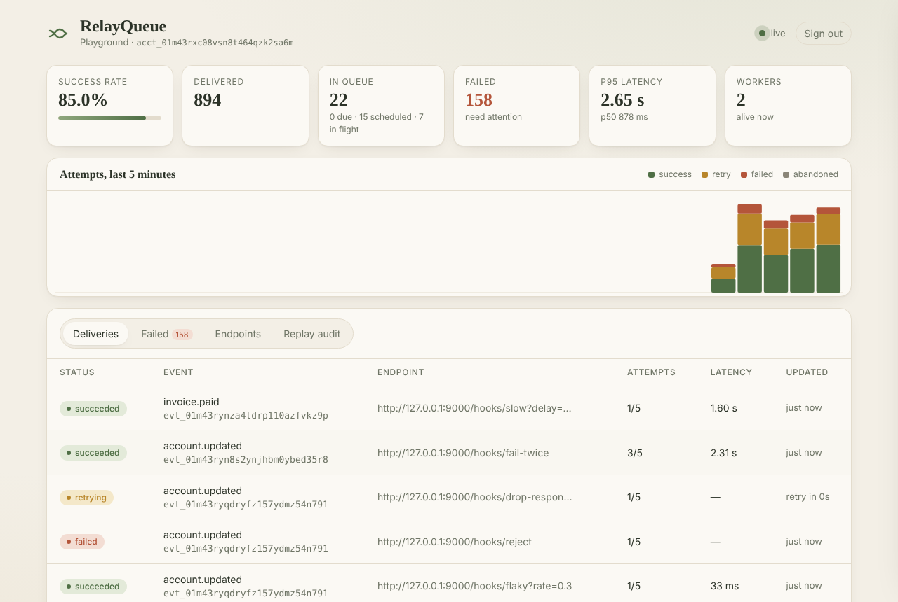
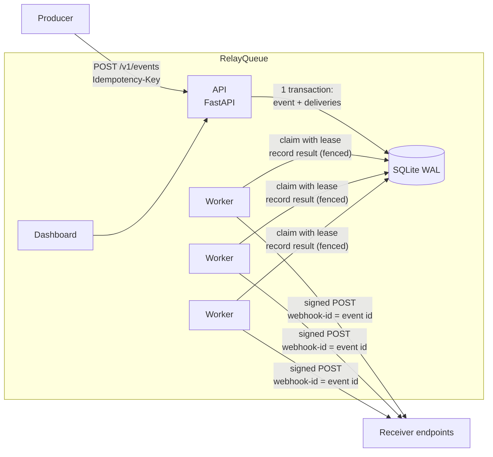
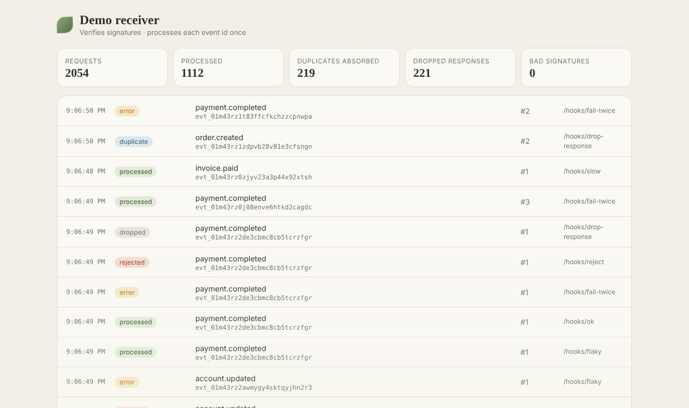

# RelayQueue

**Reliable webhook delivery.** RelayQueue accepts events, stores them durably, and delivers them asynchronously to registered endpoints. It retries temporary failures with backoff, signs every payload with HMAC, keeps a full history of every attempt, lets you replay failed deliveries with an audit trail, and recovers on its own when workers crash.



In the [chaos benchmark](demo/results/report.md), about 1,400 events were fanned out to five misbehaving endpoints while workers were `SIGKILL`ed and the receiver was taken down for 6 seconds. **6,915 of 6,915 deliveries succeeded and 0 events were lost.** This was checked against the receiver's own independent record of what it received.

---

## Contents

- [Features](#features)
- [Architecture](#architecture)
- [Quick start](#quick-start)
- [Using the API](#using-the-api)
- [Receiving webhooks](#receiving-webhooks)
- [Delivery semantics](#delivery-semantics)
- [Security](#security)
- [Proving reliability](#proving-reliability)
- [Configuration](#configuration)
- [Project layout](#project-layout)

## Features

The project was built in four stages. Each stage is its own commit.

| Stage | What it delivers |
|---|---|
| **1. One delivery works** | Register a destination. Submit an event, which is stored durably. A worker sends it, and the response status and duration are recorded. A small receiver displays incoming events. |
| **2. Failures are recoverable** | Request timeouts. Retry scheduling with exponential backoff, jitter and `Retry-After` support. Temporary and permanent failures are told apart. A maximum attempt count and a failed-delivery view. Expiring claims (leases) with fencing tokens, so work held by a crashed worker is picked up again. Idempotent submission with `Idempotency-Key`. |
| **3. Usable** | Accounts and hashed API keys, with an ownership check on every query. Delivery history with every attempt. Manual replay (single, bulk or per event) with an audit trail: who, when, why and from which state. HMAC-SHA256 signing compatible with [Standard Webhooks](https://www.standardwebhooks.com), plus secret rotation. URL validation and an SSRF guard at connect time that blocks private and internal addresses. An animated dashboard in light and dark themes. |
| **4. Proven reliable** | A demo receiver with configurable behaviour: always succeeds, fails twice and then succeeds, responds slowly, or processes the event but drops the response. Process-level tests for worker crashes, duplicate submissions and several workers running together. A chaos benchmark that measures success rate, latency and recovery time. |

## Architecture



* **The API** checks the request and writes the event and one delivery row per matching endpoint **in a single transaction**. An accepted event therefore always has its deliveries.
* **Workers** are stateless processes. Each one claims due deliveries with `BEGIN IMMEDIATE`, sets a **lease** (`lease_expires_at`) and a random **fencing token**, sends the HTTP request through an SSRF-guarded client, and records the result. Results are group-committed, so everything that finishes during one write lands in the next transaction.
* **Crash recovery needs no coordinator.** If a worker dies, its leases expire and any other worker reclaims the deliveries. The lost attempt is logged as `abandoned`, and the redelivery carries the same event id. A worker that was only *slow* and whose lease expired cannot overwrite the newer state, because its update is fenced on the token. Its late result is logged as `stale`.
* **SQLite in WAL mode** keeps the project dependency-free and easy to run. All state transitions live in [`relayqueue/store.py`](relayqueue/store.py), and the claim and fencing logic uses only standard SQL. A Postgres backend would replace the claim query with `SELECT … FOR UPDATE SKIP LOCKED`.

Delivery lifecycle:

```
pending ──claim──▶ in_flight ──2xx──────────────────────────────▶ succeeded
   ▲                 │  ├─timeout / 5xx / 408 / 425 / 429 ─▶ retrying ──(backoff)──▶ claim again
   │                 │  ├─other 4xx / 3xx / blocked address ──▶ failed (permanent)
   │                 │  └─out of attempts ─────────────────────▶ failed (exhausted)
   │                 └─lease expired (worker crashed) ──▶ reclaimed by another worker
   └──────────── manual replay (audited) ◀── succeeded | failed
```

## Quick start

### Local playground (one command)

```bash
pip install -e ".[dev,demo]"
python demo/run_local.py
```

This starts the API at <http://127.0.0.1:8000>, two workers, and the demo receiver at <http://127.0.0.1:9000>. It also creates an account, registers one endpoint for each receiver behaviour, and publishes a steady stream of events. Open the dashboard and paste the API key it prints. Interactive API docs are at `/docs`.

### Run the parts yourself

```bash
pip install -e .
export RELAYQUEUE_DB_PATH=relayqueue.db
export RELAYQUEUE_ALLOW_PRIVATE_NETWORKS=true      # only because the demo receiver is on localhost

python -m relayqueue create-account "My team"      # prints an API key (shown once)
python -m relayqueue api --port 8000
python -m relayqueue worker --worker-id w1          # start as many as you like
python demo/receiver.py --port 9000
```

### Docker

```bash
RELAYQUEUE_ADMIN_TOKEN=s3cret docker compose up --build    # API, 3 workers, demo receiver
curl -X POST localhost:8000/v1/admin/accounts -H 'x-admin-token: s3cret' \
     -H 'content-type: application/json' -d '{"name":"My team"}'
```

## Using the API

Authenticate with `Authorization: Bearer rq_…` or with `X-API-Key: rq_…`.

```bash
KEY=rq_...   # from create-account

# 1. Register a destination. The signing secret is returned once.
curl -s localhost:8000/v1/endpoints -H "authorization: Bearer $KEY" -H 'content-type: application/json' \
  -d '{"url": "http://127.0.0.1:9000/hooks/fail-twice", "event_types": ["order.*"]}'

# 2. Submit an event. Re-sending with the same Idempotency-Key returns the original event.
curl -s localhost:8000/v1/events -H "authorization: Bearer $KEY" -H 'content-type: application/json' \
  -H 'Idempotency-Key: order-1001-created' \
  -d '{"type": "order.created", "data": {"order_id": 1001, "total": 49.90}}'

# 3. Inspect the history and replay.
curl -s localhost:8000/v1/deliveries/dlv_... -H "authorization: Bearer $KEY"     # every attempt + replay audit
curl -s -X POST localhost:8000/v1/deliveries/dlv_.../replay -H "authorization: Bearer $KEY" \
  -H 'content-type: application/json' -d '{"reason": "receiver fixed"}'
```

| Method & path | Purpose |
|---|---|
| `POST /v1/admin/accounts` | Create an account and its first API key (needs `X-Admin-Token`) |
| `GET /v1/account` · `POST/GET /v1/api-keys` · `DELETE /v1/api-keys/{id}` | Identity and key management |
| `POST/GET /v1/endpoints` · `GET/PATCH /v1/endpoints/{id}` | Register, list, update, pause or resume destinations |
| `GET /v1/endpoints/{id}/secret` · `POST /v1/endpoints/{id}/rotate-secret` | Signing secret and rotation (the old secret keeps signing during a grace period) |
| `POST /v1/events` · `GET /v1/events` · `GET /v1/events/{id}` | Submit (idempotent), list and inspect events with their deliveries |
| `POST /v1/events/{id}/replay` | Replay every finished delivery of an event |
| `GET /v1/deliveries?status=&endpoint_id=&event_id=` | Delivery list |
| `GET /v1/failed-deliveries` | Deliveries that failed permanently or ran out of attempts |
| `GET /v1/deliveries/{id}` | One delivery with its attempt log (status, duration, error, worker, replay) and replay audit trail |
| `POST /v1/deliveries/{id}/replay` · `POST /v1/deliveries/replay` | Replay one delivery, or replay in bulk (e.g. all failed for an endpoint) |
| `GET /v1/replays` | Account-wide replay audit log |
| `GET /v1/stats` | Success rate, latency percentiles, queue depth, recovery stats, timeline |

## Receiving webhooks

Each request carries these headers:

| Header | Value |
|---|---|
| `webhook-id` | The **event id**. It stays the same across retries and replays, so use it to deduplicate. |
| `webhook-timestamp` | Unix seconds at signing time (defends against replay attacks) |
| `webhook-signature` | `v1,<base64 HMAC-SHA256(secret, "{id}.{timestamp}.{body}")>`. During rotation it contains two signatures separated by a space. |
| `x-relayqueue-delivery-id` · `x-relayqueue-attempt` · `x-relayqueue-event-type` | Diagnostics |

The body is the same, byte for byte, on every attempt: `{"id", "type", "created_at", "data"}`.

```python
from relayqueue.signing import verify, SignatureError   # stdlib-only; copy it into your service

def handle(request):
    try:
        event_id = verify(ENDPOINT_SECRET, request.headers, request.body)
    except SignatureError:
        return 401
    if already_processed(event_id):        # at-least-once delivery: dedupe on webhook-id
        return 200
    process(json.loads(request.body))
    mark_processed(event_id)
    return 200
```

## Delivery semantics

* **At-least-once.** A delivery counts as done only after a 2xx is *recorded*. If a worker crashes after the receiver handled a request but before the result was stored, the event is sent again with the same `webhook-id`. The same happens when a response is lost or a request times out. Receivers deduplicate on that id. In the benchmark, the demo receiver absorbed 1,406 such duplicates and none was processed twice.
* **Retries.** Temporary failures are timeouts, connection errors, `5xx`, `408`, `409`, `425` and `429`. Each one is retried after `base·2^(n-1)` seconds, capped at `backoff_max`, with equal jitter. `Retry-After` is honoured. Other `4xx` and `3xx` responses, and addresses blocked by the SSRF guard, fail at once as **permanent** failures.
* **Attempt budget.** The attempt counter goes up when a delivery is *claimed*, not when it finishes. A payload that crashes every worker that touches it therefore still runs out of attempts instead of looping forever.
* **Replay** resets the attempt budget. It keeps the full history: attempts are tagged with the `replay_id`, and the audit row records the actor (API key name and prefix), the reason, the previous status, the previous error and the attempt count. Only finished deliveries can be replayed. Replaying one that is still scheduled returns `409`.
* **Paused endpoints** hold their deliveries. Nothing is dropped, and delivery resumes when the endpoint is re-enabled.

## Security

* **API keys** look like `rq_` plus 256 random bits. Only a SHA-256 hash is stored, and keys can be revoked. **Every query is scoped to the account that owns the key**, and another account's resources return `404`, so their existence is not revealed. Idempotency keys are also scoped per account.
* **SSRF protection** has two layers:
  1. When an endpoint is created or updated, the URL must be `http(s)` and have no embedded credentials. Every resolved address must be public. Loopback, RFC 1918, link-local (including the `169.254.169.254` cloud metadata address), CGNAT, ULA, multicast, reserved, IPv4-mapped/6to4/Teredo, `localhost` and `*.internal` are rejected.
  2. **At connect time**, a custom network backend resolves the host again, checks every address and connects to the vetted IP. This blocks DNS-rebinding attacks. TLS is still verified against the hostname. The delivery client ignores proxy environment variables and never follows redirects.
* **Signing secrets** are 256-bit and can be rotated with a grace period during which both secrets sign.

Set `RELAYQUEUE_ALLOW_PRIVATE_NETWORKS=true` only for local development. The playground, tests and compose file use it because the demo receiver runs on localhost.

## Proving reliability

### Demo receiver

[`demo/receiver.py`](demo/receiver.py) works like a well-behaved consumer. It verifies signatures, handles each event id once, and keeps a ground-truth ledger. Each path selects a behaviour:

| Path | Behaviour |
|---|---|
| `/hooks/ok` | Always succeeds |
| `/hooks/fail-twice` | `500`, `500`, then `200` (counted per event id) |
| `/hooks/slow?delay=3&times=0` | Responds slowly. With a delay longer than the timeout, the receiver still processes the event and the retry becomes a duplicate. |
| `/hooks/drop-response?times=1` | **Processes the event, then closes the socket without answering** |
| `/hooks/flaky?rate=0.3` · `/hooks/down` · `/hooks/reject` | Random `503` · always `503` · always `400` (permanent) |

`POST /_control {"outage": true}` simulates an outage. `{"healed": true}` makes `down` and `reject` start succeeding, which is useful for showing a replay. The receiver also has its own animated page:



### Tests

```bash
pytest -q            # 76 tests, ~45 s
```

| File | Covers |
|---|---|
| `test_stage1_delivery.py` | End-to-end delivery and recorded status and duration |
| `test_stage2_failures.py` | Failure classification (13 cases), backoff, `Retry-After`, retry until success, permanent failures, attempt cap, timeouts, **lease expiry and recovery**, fencing of stale workers, poison deliveries, 6 concurrent claimers never sharing a delivery, idempotency (sequential and 12 concurrent submissions) |
| `test_stage3_usable.py` | Auth, key revocation, hashed storage, **cross-account isolation**, event-type routing, signature verification and tampering, rotation, a stable id across retries, **audited replay**, bulk replay, pause and resume, **18 SSRF cases**, DNS-to-private, connect-time blocking |
| `test_stage4_reliability.py` | Every receiver behaviour, forged signatures, and **real processes**: a worker `SIGKILL`ed mid-delivery and recovered, graceful drain on `SIGTERM`, 50 concurrent duplicate submissions over HTTP, **3 workers sharing 300 deliveries with zero double delivery**, a receiver outage combined with a worker crash |

### Chaos benchmark

```bash
python demo/chaos.py        # ~1 min; writes demo/results/report.md, report.json, timeline.png
```

This publishes 40 events per second for 38 seconds to five endpoints (`ok`, `fail-twice`, `slow`, `drop-response`, `flaky`), with 10% duplicate submissions. Three worker processes run while the following faults are injected:


| Metric | Result |
|---|---|
| Delivery success rate | **100.00%** (6,915 / 6,915) |
| Events lost (checked against the receiver's ledger) | **0** |
| Duplicate deliveries absorbed by the receiver | 1,406 (all processed only once) |
| Duplicate submissions collapsed by `Idempotency-Key` | 137 of 1,520 POSTs → 1,383 events |
| End-to-end latency, calm period, p50 / p95 / p99 | 74 ms / 194 ms / 288 ms |
| End-to-end latency, whole run including retries and outages, p50 / p95 / p99 | 604 ms / 8.61 s / 12.79 s |
| **Single worker `SIGKILL`**: all orphaned claims reclaimed | 3.8 s (lease = 4 s); completed 4.2 s after the kill |
| **6 s receiver outage**: queue back to baseline after recovery | 9.4 s (queue peak 1,162; backlog p50 2.7 s) |
| **All 3 workers `SIGKILL`ed for 3 s**: claims reclaimed after restart | 1.0 s; pre-crash backlog delivered in 2.6 s |
| **Graceful `SIGTERM`**: drain time / orphaned claims | 0.4 s / 0 |
| Throughput (SQLite, 3 workers, laptop-class VM) | ~178 deliveries/s |

The full report, including per-endpoint latency and attempt outcomes, is in [demo/results/report.md](demo/results/report.md). CI runs the benchmark on every push and fails if any event is lost.

## Configuration

All settings are environment variables:

| Variable | Default | Meaning |
|---|---|---|
| `RELAYQUEUE_DB_PATH` | `relayqueue.db` | SQLite file shared by the API and workers |
| `RELAYQUEUE_ADMIN_TOKEN` | — | Enables `POST /v1/admin/accounts` |
| `RELAYQUEUE_ALLOW_PRIVATE_NETWORKS` | `false` | Allow private and loopback destinations (development only) |
| `RELAYQUEUE_REQUEST_TIMEOUT` | `10` | Seconds per delivery attempt |
| `RELAYQUEUE_MAX_ATTEMPTS` | `8` | Attempt budget per delivery (and per replay) |
| `RELAYQUEUE_BACKOFF_BASE` / `_MAX` | `2` / `600` | Exponential backoff in seconds |
| `RELAYQUEUE_LEASE_SECONDS` | `30` | Claim lease length. It must be longer than the request timeout, and it sets the upper bound on crash-recovery time. |
| `RELAYQUEUE_WORKER_CONCURRENCY` | `16` | Concurrent requests per worker |
| `RELAYQUEUE_POLL_INTERVAL` | `0.25` | Idle poll interval in seconds |
| `RELAYQUEUE_ROTATION_GRACE` | `86400` | How long the previous secret keeps signing after a rotation |

## Project layout

```
relayqueue/
  api.py          HTTP API, auth, ownership checks
  store.py        all state transitions: ingest, claim/lease, fenced results, replay
  worker.py       async delivery worker, failure classification, group commit
  urlguard.py     URL validation + connect-time SSRF guard
  signing.py      Standard Webhooks HMAC signing / verification
  retry.py        backoff, Retry-After, retryable status codes
  metrics.py      success rate, latency percentiles, recovery stats
  static/dashboard.html
demo/
  receiver.py     configurable demo receiver (verifies signatures, dedupes)
  harness.py      spawns real API / worker / receiver processes
  chaos.py        fault-injection benchmark → demo/results/
  run_local.py    one-command playground
tests/            76 tests across the four stages
```

### Known limits and next steps

* SQLite has a single writer, which caps throughput at a few hundred deliveries per second. The storage layer is isolated so it can be replaced with Postgres (`SKIP LOCKED`) to scale horizontally.
* Delivery order is not guaranteed, even per endpoint. This is the usual trade-off for webhooks, and consumers should rely on `created_at` or the event id.
* There is no per-endpoint circuit breaker or rate limit yet. A long outage is absorbed by backoff alone.
