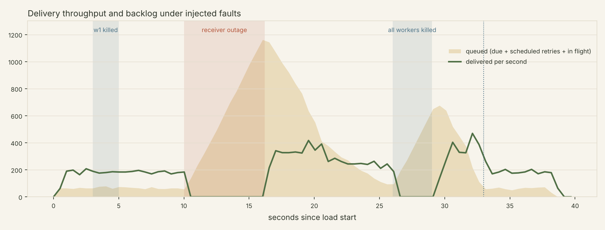

# RelayQueue chaos benchmark

_Generated 2026-10-04 15:33:29 Asia by `python demo/chaos.py`._

Load: **40 events/s for 38s**, fanned out to 5 endpoints with different behaviours (`ok`, `fail-twice`, `slow?delay=0.4`, `drop-response`, `flaky?rate=0.2`), 3 worker processes. Faults injected: one worker SIGKILLed, a 6s receiver outage (process killed), all workers SIGKILLed for 3s, and a graceful rolling restart.

## Headline numbers

| Metric | Result |
|---|---|
| Delivery success rate | **100.00%** (6,915 / 6,915) |
| Events lost (receiver ground truth) | **0** |
| Acked by RelayQueue but never received | **0** |
| Duplicate deliveries absorbed by receiver (same `webhook-id`) | 1,406 |
| Signature verification failures | 0 |
| Half-sent requests cut off by a SIGKILLed worker (discarded by receiver) | 0 |
| Duplicate submissions collapsed by `Idempotency-Key` | 137 of 1,520 POSTs → 1,383 events |
| First-attempt success rate | 46.2% |
| End-to-end latency, calm period (`ok` endpoint) p50 / p95 / p99 | 74 ms / 194 ms / 288 ms |
| End-to-end latency, whole run incl. retries p50 / p95 / p99 | 604 ms / 8.61 s / 12.79 s |
| Throughput | 178.1 deliveries/s |

## Recovery

| Fault | Measurement | Result |
|---|---|---|
| Single worker SIGKILL | claims orphaned | 3 |
| | all orphaned claims reclaimed after kill | 3.774 s (lease = 4 s) |
| | all orphaned deliveries completed after kill | 4.185 s |
| Receiver outage (6.21 s) | deliveries that hit the outage | 1,181 |
| | queue depth: baseline → peak | 64 → 1162 |
| | queue back to baseline after receiver returned | 9.37 s |
| | backlog delivered after receiver returned, p50 / p95 / max | 2.7 s / 8.7 s / 13.85 s |
| All 3 workers SIGKILL (3.01 s down) | claims orphaned | 23 |
| | orphaned claims reclaimed after restart | 0.961 s |
| | pre-crash backlog delivered after restart | 2.553 s |
| Graceful SIGTERM | drain time / orphaned claims | 0.416 s / 0 |

## Per endpoint

| Endpoint behaviour | Requests | Unique processed | Duplicates absorbed | Latency p50 | p95 | p99 |
|---|---|---|---|---|---|---|
| `drop-response` | 2,766 | 1,383 | 1,383 | 379 ms | 9.53 s | 10.91 s |
| `fail-twice` | 4,151 | 1,383 | 2 | 897 ms | 12.70 s | 16.55 s |
| `flaky?rate=0.2` | 1,741 | 1,383 | 1 | 282 ms | 6.66 s | 10.05 s |
| `ok` | 1,384 | 1,383 | 1 | 104 ms | 6.42 s | 7.61 s |
| `slow?delay=0.4` | 1,402 | 1,383 | 19 | 520 ms | 7.02 s | 8.69 s |

## Attempt outcomes

| Outcome | Count |
|---|---|
| abandoned | 26 |
| retry | 9,463 |
| success | 6,915 |

`abandoned` attempts are claims whose worker was killed before recording a result; each was reclaimed after its lease expired and redelivered with the same event id.

## How to read this

* **Success rate / events lost** are checked twice: RelayQueue's own records, and the receiver's independent ledger of event ids it processed.
* **Duplicates absorbed** is the cost of at-least-once delivery: when a worker dies mid-request, the response is dropped, or a request times out after the receiver already did the work, the event is redelivered with the same `webhook-id`, and the receiver skips it.
* After the outage, deliveries that already failed several times are waiting out their exponential backoff (capped at `backoff_max`), and `fail-twice` events still need two more failures, which is why the slowest backlog items arrive later than the queue returns to normal.
* Latency "whole run" includes events deliberately delayed by retries (`fail-twice`, `flaky`, `drop-response`) and by the injected outages.
